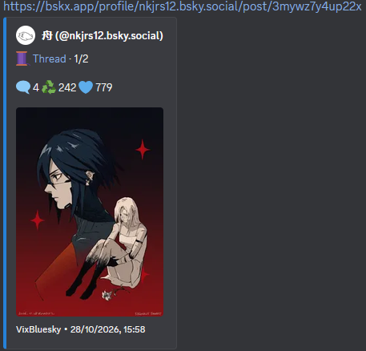
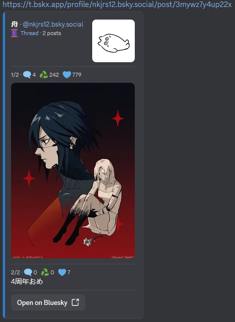
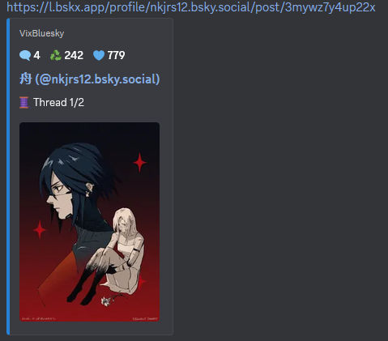
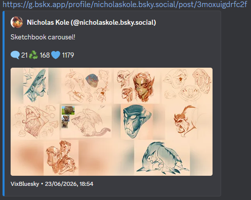
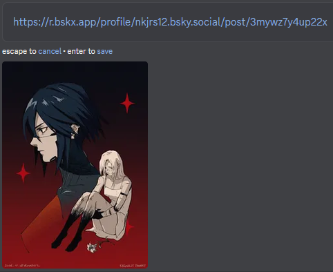

# VixBluesky 🛠️ (Inspired by [FixTweet](https://github.com/FixTweet/FixTweet))

Embed Bluesky links in Discord.

> [!IMPORTANT]
> If you are still using the old domain (`bskyx.app`) you should consider switching to `bskx.app` since `bskyx.app` only supports Raw Media access.
> I do not plan to backports other features to this domain.

## Fix embeds with `s/y/x`.

> [!NOTE]
> This is a fork of [FixBluesky](https://github.com/ThornbushHQ/FixBluesky) by [@ItsRauf](https://www.github.com/ItsRauf).
> All credits go to them for the original idea and implementation.

## How To Use?

#### Simply replace `y` with x in `bsky.app`. (`bsky.app` -> `bskx.app`)

### Flags
Prepend a letter as a subdomain. Combine flags by stacking subdomains in any order, e.g. `r.g.bskx.app` or `g.r.bskx.app`.

| Letter | Effect |
| ------ | ------ |
| `r` | Raw media: redirect straight to the media (video first, then images; `/{n}` to choose the index of the image (0-based)) |
| `g` | Gallery: combine all images into a single image |
| `v` | Serve videos through the VixBluesky video API (now that custom PDSes are supported, it is mostly irrelevant) |
| `l` | Legacy embed: OpenGraph/oEmbed tags instead of the rich Discord embed |
| `t` | Thread reader: the linked post and the ones that follow it in the author's thread (Discord only) |

Query parameters work too, and override the subdomain both ways: `?direct=true`, `?gallery=true`, `?video_api=true`, `?legacy=true`, `?thread=true` (or `=false` to switch one off).

### Previews

No flag: the default embed

`https://bskx.app/profile/nkjrs12.bsky.social/post/3mywz7y4up22x`

<kbd>t</kbd>: thread reader

`https://t.bskx.app/profile/nkjrs12.bsky.social/post/3mywz7y4up22x`

<kbd>l</kbd>: legacy embed

`https://l.bskx.app/profile/nkjrs12.bsky.social/post/3mywz7y4up22x`

<kbd>g</kbd>: gallery

`https://g.bskx.app/profile/nicholaskole.bsky.social/post/3moxuigdrfc2f`

<kbd>r</kbd>: raw media

`https://r.bskx.app/profile/nkjrs12.bsky.social/post/3mywz7y4up22x`

## For developers
You can append `/json` at the end of each url to get the raw data VixBluesky receives.

> [!WARNING]
> __When querying the VixBluesky API, please DO use a descriptive User-Agent. This is used to your identify traffic and avoid abuse.__
> 
> A descriptive User-Agent should include at least: the name of the application, the version of the application (if applicable), and optionally a link to a website. 
> Generally, it should somewhat looks like this `YourApp (v1.7.10, https://repo.git (or any identifiable URL))`.

## Authors

- [@ItsRauf](https://www.github.com/ItsRauf) - Original author
- [@Lexedia](https://www.github.com/Lexedia)
